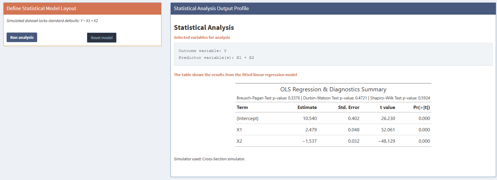
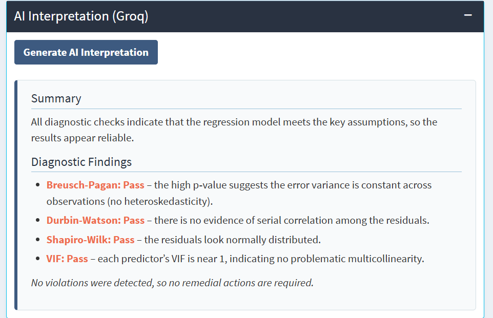

# diag_lm: Automated Regression Diagnostics with a Shiny Dashboard

`diag_lm` is an R framework and interactive Shiny app that fits a regression model, automatically runs the diagnostic tests that fit that kind of model, and returns clear **PASS / CHECK** verdicts with plots and advice on what to do next. An optional AI layer explains the results in plain language.

It covers four kinds of models:

| Model family | Diagnostics |
| --- | --- |
| Linear regression (OLS) | Breusch-Pagan (heteroskedasticity), VIF (multicollinearity), Shapiro-Wilk and Jarque-Bera (normality), Durbin-Watson and Breusch-Godfrey (autocorrelation) |
| Logistic regression | Hosmer-Lemeshow goodness of fit, AUC, confusion matrix, separation check |
| Univariate time series | Augmented Dickey-Fuller (stationarity), Ljung-Box (residual autocorrelation) |
| Panel data (`plm`) | Pipeline of LM test (pooled vs. panel) → F test → Hausman (fixed vs. random effects) → serial correlation → two-way effects |

Group project for *Advanced R for Econometricians*, University of Duisburg-Essen (Summer Semester 2026), by **Rezaul Hoque**, **Sarah Al-Talal** and **Thi Hong Cam Nguyen**.



## What it does

- **One S3 abstraction for all model types.** `new_diag_lm()` takes a fitted model and returns a `diag_lm` object with `print()`, `summary()`, `plot()` and `remediation_advice()` methods. The statistical logic stays separate from the user interface.
- **Data simulators with switchable assumption violations.** These generate OLS, logistic, time-series and panel data with a chosen problem built in (for example heteroskedasticity or multicollinearity), so you can check that each test catches exactly what it should.
- **Privacy-aware AI interpretation (optional).** When you ask for it, only the computed statistics are sent to an LLM (Groq via the `ellmer` package), never the raw data. The model then explains what the diagnostics mean.
- **Tested.** Checks for the class and the AI layer, plus Shiny integration tests (`shiny::testServer`) that exercise the full reactive pipeline from inputs to outputs.

## Results from the validation study

- **Simulation:** every test flagged exactly the violation it targets: Breusch-Pagan p < 0.0001 under heteroskedasticity, VIF 15.68 under multicollinearity, and a Hausman test (p = 0.0001) that correctly selected fixed effects over random effects.
- **Case study:** on real wage data (N = 8,328), the app detected heteroskedasticity and a 14% gender wage gap.
- **Quality assurance:** an audit fixed 8 defects, which are now guarded by 9 automated server tests.

The full write-up is in [`report/Hoque_AlTalal_Nguyen_diag_lm_ProjectReport.pdf`](report/Hoque_AlTalal_Nguyen_diag_lm_ProjectReport.pdf).



## Repository structure

```
.
├── app.R                     # Shiny dashboard (UI + server)
├── R/
│   ├── diag_lm_class.R       # diag_lm S3 class: constructors, summary/plot methods, remediation advice
│   ├── simulate_data.R       # simulate_ols_data(), simulate_logit_data(), simulate_ts_data(), simulate_panel_data()
│   └── llm_interpret.R       # optional plain-language interpretation via Groq (ellmer)
├── data/                     # example datasets (wage, titanic, stock indices, student rental panel, cars)
├── tests/
│   ├── test_diag_lm.R        # checks for the diag_lm class
│   ├── test_llm_interpret.R  # checks for the AI layer (no network calls)
│   └── test_app_server.R     # Shiny integration tests with shiny::testServer()
├── report/                   # project report (R Markdown source and PDF)
└── presentation/             # final presentation
```

## How to run

1. Install R (4.3 or newer) and the packages:

   ```r
   install.packages(c("shiny", "shinydashboard", "dplyr", "tibble", "ggplot2", "gt",
                      "lmtest", "sandwich", "car", "plm", "tseries", "here",
                      "htmltools", "commonmark", "ellmer"))
   ```

2. Start the app from the project root:

   ```r
   shiny::runApp()
   ```

3. **Optional, for the AI interpretation:** create a free API key at [console.groq.com](https://console.groq.com) and add it to a `.Renviron` file in the project root (this file is git-ignored):

   ```
   GROQ_API_KEY=your_key_here
   ```

   Everything else works without a key. Without one, the AI panel shows a short note on how to set it up.

## Running the tests

From the project root:

```r
source("tests/test_diag_lm.R")
source("tests/test_llm_interpret.R")
source("tests/test_app_server.R")
```

## Tech stack

R, Shiny and shinydashboard, S3 classes, lmtest, sandwich, car, plm, tseries, ggplot2, gt and ellmer (Groq API), with R Markdown and LaTeX for the report.
